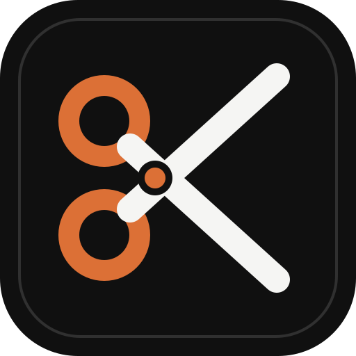

<p align="center">
  
</p>

<h1 align="center">左人剪刀 (ZuorenJiandao)</h1>

<p align="center">
  <strong>简体中文</strong> · <a href="README_EN.md">English</a>
</p>

<p align="center">
  <strong>本地优先的桌面视频剪辑软件 · 专注多轨精剪、长片流畅度、硬件混合导出与外部 MCP 协作</strong>
</p>

<p align="center">
  <a href="https://github.com/barbarians1999/ZuorenJiandao/releases"></a>
  
  
  
  
  
  
</p>

---

## 软件定位

**左人剪刀（ZuorenJiandao）** 是一款专为长片与日常内容创作者打造的**纯本地桌面视频剪辑工具**：

- **零云端绑定，开箱即剪**：工程文件、媒体索引、语音识别、特效合成与渲染导出全部在本地硬盘完成，无需注册账号，也无需配置任何云端大模型 API 密钥。
- **可控、可撤销的时间线工作流**：面向真实长工程（多轨素材、画中画、密集字幕、高频拖动）打磨交互与性能；同时支持通过外部 MCP 接口与 Codex、Claude Code、Cursor、Antigravity 等外部 AI 助手协作，所有外部改动都会直接落到可撤销、可微调的时间线工程中。
- **Windows 桌面端深度加固**：配备 SQLite 耐用工程存储、文件防锁重试、导出目标断点恢复、应用内深色主题弹窗、矮屏/小窗口自适应缩放，以及 AMD AMF / NVIDIA NVENC / Intel QSV 硬件加速导出链路。

---

## 核心功能

- **多轨时间线与快捷操作**：支持多视频轨、音频轨、字幕轨、特效与独立马赛克专轨；提供磁吸主轨、定向联动、波纹/滚动裁剪、滑移、变速、时间轴标记（`M`）、入出点区间（`I`/`O`）、可编辑子草稿，以及顶栏一键切换**剪映 / PR / 自定义**快捷键方案。
- **预览监视与长片流畅度**：
  - 预览区配备紧凑播控与监视条（双时间码、带标记点与入出点的时间轴、快退/逐帧/快进、全分辨率静帧导出）。
  - 支持原片 / 流畅代理切换与硬件代理生成、跨切点解码画布复用、合并防抖拖动以及本地素材单击实时预览。
  - 素材库支持**全部状态 / 已使用 / 未使用**筛选，并可一键新建黑场、白场与遮罩视频。
- **全功能高速与分段混合硬件导出**：
  - 导出前实时预检路线（`极速硬件导出` / `分段混合导出` / `完整逐帧渲染`）并在完成后展示各阶段耗时账单。
  - 原生 FFmpeg 硬件通道直接覆盖多段裁剪拼接、局部高斯模糊/局部马赛克/全屏像素化、矩形与圆形遮罩、`.cube` 3D LUT 调色、AI 降噪干湿混合、背景音自动闪避、音频交叉淡化、分段线性音量关键帧、`0.25x–4.0x` 变速与基础转场。
  - 遇到画中画多层叠放、特殊转场（如翻页）或复杂关键帧时，仅将局部受影响区间自动分流到逐帧精细渲染，其余全片仍保持硬件高速导出并无损拼合。
- **字幕与文字一体化工作流**：支持离线 Whisper 语音识别、文稿对齐、字幕列表校对与颜色/字体同行微调、内置多款中英文字体以及 SRT 导入导出。
- **本地视觉与音频工具**：内置矩形/椭圆/纯色背景、独立马赛克区域拖拽控制、WebGL 特效与转场、关键帧、蒙版、本机人像分割与本地语义素材检索。
- **外部 MCP 自动发现与状态检测**：软件启动后自动写入本地发现信息，可在**设置 → 外部控制**一键查看 Codex / Claude Code / Cursor / Antigravity 连接状态与接入配置。

---

## 下载与安装（Windows 64 位）

1. 前往 [Releases 页面](https://github.com/barbarians1999/ZuorenJiandao/releases) 下载最新版本的 Windows 安装程序（例如 `ZuorenJiandao-Setup-0.5.9-x64.exe`）。
2. 双击运行安装程序。
   > **提示**：当前版本安装包暂未附带商业数字签名。如果 Windows 弹出“Windows 已保护你的电脑”蓝色提示框，点击 **更多信息 → 仍要运行** 即可正常安装。

---

## 外部 MCP 连接说明

软件启动后会在本机暴露外部 MCP 服务（默认地址：`http://localhost:5199/api/external-mcp/mcp`）。
可以在软件界面右上角点击**外部控制（插头图标）**或在 **设置 → 外部控制** 中查看实时连接状态、自动发现路径及客户端接入方式；连接操作完全由用户主动控制。

---

## 本地开发与构建

环境要求：**Node.js 24**、**pnpm**。

```bash
# 安装依赖
pnpm install

# 启动开发环境（桌面端）
npm run desktop:dev

# 类型检查与代码规范检查
npx tsc -b --pretty false
npm run lint

# 构建 Windows 桌面端发布产物
npm run desktop:dist:win
```

开发规范、本地数据目录策略与功能边界请参考 [DEVELOPMENT_BOUNDARIES.md](DEVELOPMENT_BOUNDARIES.md)。

---

## 开源协议

- 开源协议：[AGPL-3.0-or-later](LICENSE)（早期代码基于 [OpenChatCut](https://github.com/0xsline/OpenChatCut) 演进）
