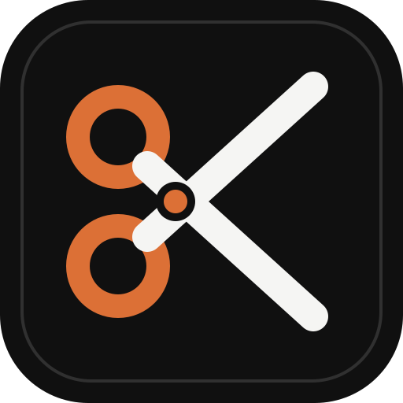

<p align="center">
  
</p>

<h1 align="center">ZuorenJiandao (左人剪刀)</h1>

<p align="center">
  <a href="README.md">简体中文</a> · <strong>English</strong>
</p>

<p align="center">
  <strong>Local-first desktop video editor · Focused on multitrack editing, long-project responsiveness, hybrid hardware export, and external MCP control</strong>
</p>

<p align="center">
  <a href="https://github.com/barbarians1999/ZuorenJiandao/releases"></a>
  
  
  
  
  
  
</p>

---

## Overview

**ZuorenJiandao (左人剪刀)** is a local-first desktop video editor built for long-form and everyday creators:

- **100% Local Workflow, Zero Cloud Lock-in**: Project storage, media indexing, speech recognition, effects compositing, and rendering all run locally on your machine—no account or cloud LLM API key is required.
- **Deterministic Timeline + Optional External MCP Control**: Engineered for heavy timelines with hundreds of clips and dense captions. External AI assistants (such as Codex, Claude Code, Cursor, or Antigravity) can optionally connect via MCP to issue undoable edits directly onto the real timeline.
- **Desktop Reliability Hardening**: Built on SQLite-backed durable project storage, transient file-lock retries, post-render export destination recovery, theme-matched close confirmation, compact-window responsive scaling (`1024×680`), and hardware-accelerated export (AMD AMF, NVIDIA NVENC, Intel QSV).

---

## Features

- **Multitrack Timeline & Shortcut Presets**: Video, audio, caption, effect, and dedicated mosaic tracks with snapping, magnetic main track, directional linkage, rolling/slip trim, rate stretch, timeline markers (`M`), in/out zones (`I`/`O`), nested sub-drafts, and one-click **Jianying / Premiere Pro / Custom** shortcut presets.
- **Preview Monitor & Long-Project Responsiveness**:
  - Dedicated preview monitor bar with dual timecodes, marker/zone scrub track, shuttle/frame-step transport, and full-resolution still-frame export.
  - Original/proxy playback toggle with hardware-accelerated proxy generation, cross-cut decoder reuse, coalesced scrubbing, and instant source-asset preview.
  - Media pool usage filters (**All / Used / Unused**) and one-click black/white matte and mask clip generators.
- **Segmented Hybrid Hardware Export**:
  - Real-time export route preflight (**Fast Hardware / Segmented Hybrid / Full Frame Render**) plus per-stage timing breakdown.
  - Native FFmpeg hardware pipeline accelerates multi-segment cuts, local Gaussian blur/mosaic/pixelate, rectangle/circle masks, `.cube` 3D LUT grading, AI voice denoise dry/wet mix, audio ducking, audio cross-fade, linear volume keyframes, `0.25x–4.0x` retiming, and basic transitions.
  - Complex spans (such as picture-in-picture overlaps or `page-curl` transitions) automatically route only the affected frames through frame-accurate Remotion rendering while keeping the rest of the timeline in the hardware fast path.
- **Unified Captions & Text Workflow**: Offline Whisper speech recognition, pasted transcript alignment, inline caption styling controls, bundled Chinese/English fonts, and SRT import/export.
- **Local Visual & Audio Tools**: Shapes, solid backgrounds, canvas-draggable mosaic regions, WebGL effects & transitions, keyframes, masks, on-device segmentation, and local semantic media search.
- **External MCP Discovery & Status Inspection**: Writes runtime discovery metadata automatically and inspects connected external clients in **Settings → External Control**.

---

## Download & Install (Windows x64)

1. Download the latest Windows installer (`ZuorenJiandao-Setup-0.5.1-x64.exe`) from [GitHub Releases](https://github.com/barbarians1999/ZuorenJiandao/releases).
2. Double-click to install.
   > **Note**: The installer is currently unsigned (`NotSigned`). If Windows SmartScreen displays a prompt, click **More info → Run anyway** to proceed.

---

## External MCP Endpoint

When running, the local external MCP endpoint is available by default at `http://localhost:5199/api/external-mcp/mcp`. Use the plug icon in the editor top bar or **Settings → External Control** to inspect connection status and client setup.

---

## Local Development & Build

Requirements: **Node.js 24** and **pnpm**.

```bash
# Install dependencies
pnpm install

# Run desktop dev environment
npm run desktop:dev

# Typecheck & lint
npx tsc -b --pretty false
npm run lint

# Build Windows desktop installer & unpacked output
npm run desktop:dist:win
```

See [DEVELOPMENT_BOUNDARIES.md](DEVELOPMENT_BOUNDARIES.md) for feature, storage, and delivery guidelines.

---

## License

- Licensed under [AGPL-3.0-or-later](LICENSE) (originally derived from [OpenChatCut](https://github.com/0xsline/OpenChatCut))
